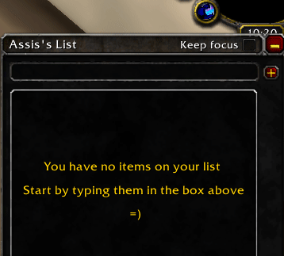

# TodoChecklister

A todo list for World of Warcraft. Write down the bosses to kill, the items to farm and the route to take, then tick them off.

## Download

- [CurseForge](https://www.curseforge.com/wow/addons/todochecklister/files)
- [Wago](https://addons.wago.io/addons/todochecklister)
- [GitHub releases](https://github.com/AssisrMatheus/TodoChecklister/releases)
- [WoWInterface - Retail & Forever](https://www.wowinterface.com/downloads/info25349-TodoChecklister.html)
- [WoWInterface - Classic](https://www.wowinterface.com/downloads/info25348-TodoChecklister.html)

## Compatible with WoW Forever!!

TodoChecklister runs on WoW: Forever.

It also runs on Retail, Classic Era, TBC Anniversary and Mists of Pandaria Classic.

## Features

- **Shared lists:** keep as many named lists as you want. Every character on your account sees them, and each one picks which list its window shows. Create, switch and delete lists in Esc > Options > AddOns > TodoChecklister, or from chat with `/todo lists` and `/todo switch`.
- **Share lists:** Export list in the options gives you a text to copy and send to anyone. They paste it into Import list and get a copy of the list, folders and checked items included. It works across every game version.
- **Quick add:** tick it at the top of the window and the text box stays active after Enter, so you can type the next item right away.
- **Item links:** shift-click an item from your bags and the list shows how many you carry.
- Drag to reorder, click to edit, and checked items get a strikethrough.

## How to use it

Extract the download into your client's `Interface\AddOns` folder, so you end up with `AddOns\TodoChecklister\TodoChecklister.toc`.

Open the window with the minimap button, a keybind (Esc > Options > Keybindings > AddOns) or `/todo tg`.

| Command | What it does |
|---|---|
| `/todo help` | Lists the commands in chat |
| `/todo tg` | Opens or closes the window |
| `/todo reload` | Resets the window size, position and scale |
| `/todo add {text}` | Adds `{text}` to the list |
| `/todo rmv {position}` | Removes the item at `{position}` |
| `/todo mv {from} {to}` | Moves an item. `/todo mv 1 3` moves the first item to the third slot |
| `/todo chk {position}` | Checks or unchecks the item at `{position}` |
| `/todo lists` | Shows your saved lists, numbered |
| `/todo switch {position or name}` | Displays another list. `/todo switch 2` or `/todo switch Raid night` |

## Contributing

Report bugs on [GitHub issues](https://github.com/AssisrMatheus/TodoChecklister/issues). To work on the code, read [CONTRIBUTING.md](./CONTRIBUTING.md).
